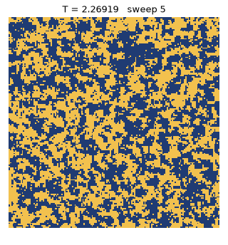
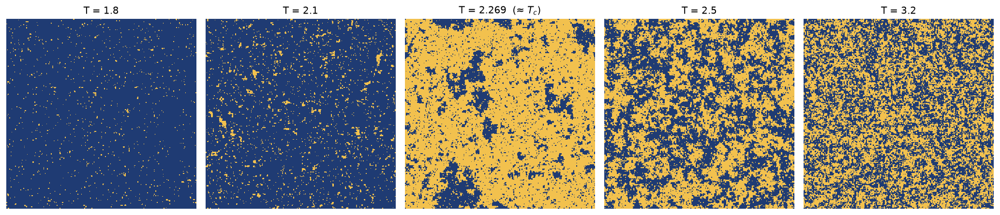
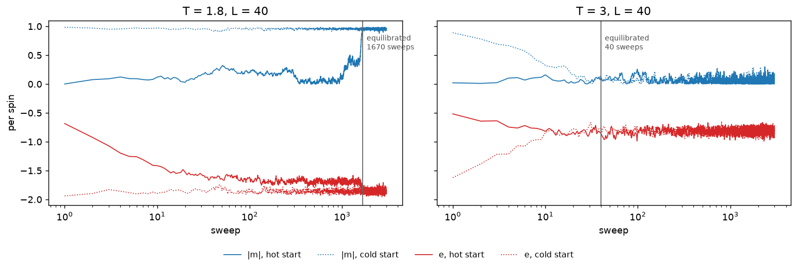
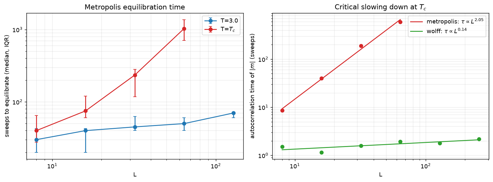
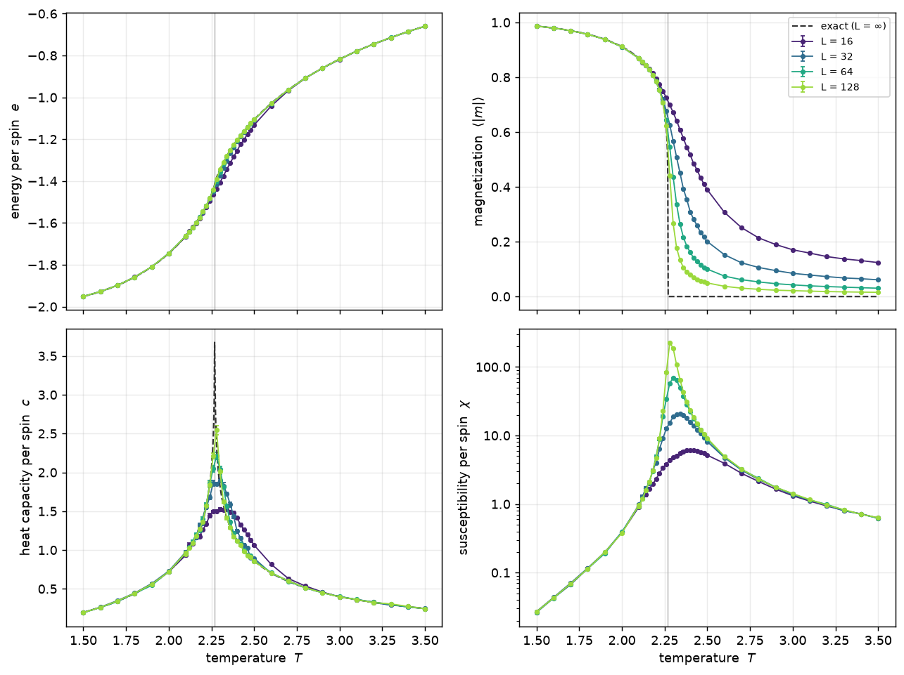
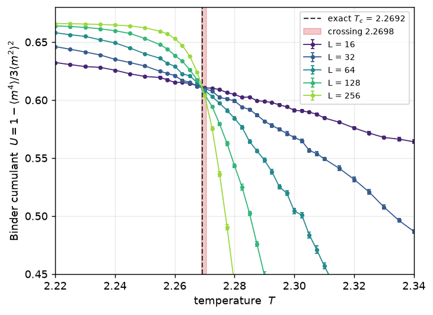
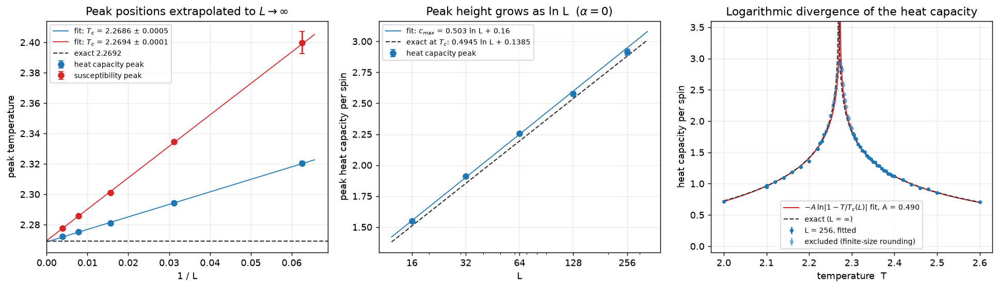

# Monte Carlo simulation of the 2D Ising model

<p align="center">
  
</p>

A fast, tested Python package for simulating the nearest-neighbour Ising model on
1D chains and 2D square lattices, measuring its thermodynamics with proper error
bars, and locating the phase transition. Updates run in
[numba](https://numba.pydata.org/)-compiled kernels: single-spin **Metropolis**
and **Wolff** cluster updates.

The animation above is a 160 × 160 lattice at the critical temperature,
starting from random spins. Domains grow until they look the same at every
length scale, which is the signature of a critical point.

## Contents

- [Quick start](#quick-start)
- [The model](#the-model)
- [Algorithms](#algorithms)
- [Equilibration](#equilibration)
- [Thermodynamics](#thermodynamics)
- [Locating the critical temperature](#locating-the-critical-temperature)
- [Validation](#validation)
- [Development](#development)
- [License](#license)

## Quick start

```bash
git clone https://github.com/karlokr/ising.git
cd ising
python -m venv .venv && source .venv/bin/activate
pip install -e ".[dev]"
```

### Command line

The `ising` command has four subcommands: `run`, `scan`, `equilibrate` and `animate`.

```console
$ ising run --T 2.269 --L 64 --algorithm wolff --seed 1
T = 2.269, 4096 sites, 10000 samples
  energy           -1.42311 ± 0.001
  magnetization    -0.000180322 ± 0.0088
  |magnetization|  0.598401 ± 0.0029
  heat capacity    2.228 ± 0.053
  susceptibility   47.6102 ± 1.4
  binder cumulant  0.609883 ± 0.0017
  tau_int (sweeps) energy 2.92, |M| 1.98
  wolff, 11000 sweeps in 1.30 s
```

The same run with Metropolis shows why the autocorrelation time is printed.
At $T_c$ it is about 200 sweeps, so 10 000 sweeps are only ~50 independent
samples. The susceptibility comes out at half its true value. The tool
detects that its error bars can't be trusted and says so:

```console
$ ising run --T 2.269 --L 64 --seed 1
  ...
  susceptibility   25.1602 ± 2.9
  tau_int (sweeps) energy 117, |M| 211
  warning: blocks of 500 sweeps are shorter than 10 autocorrelation times, so errors are underestimated; run longer or use wolff
```

```console
$ ising scan --T 2.0:2.5:0.1 --L 32 --algorithm wolff --seed 1 --out scan.csv --plot scan.png
L = 32: 6 temperatures in 0.9 s
        T          e       |m|         c        chi       U
   2.0000   -1.74520   0.91109    0.7350     0.3926  0.6655
   2.1000   -1.66240   0.86896    0.9765     0.9674  0.6635
   2.2000   -1.54548   0.78415    1.4901     4.6805  0.6515
   2.3000   -1.37042   0.55879    1.9430    19.6244  0.5617
   2.4000   -1.21113   0.31305    1.2860    16.0017  0.3287
   2.5000   -1.11025   0.20480    0.8987     8.4344  0.1693
saved scan.csv
saved scan.png
```

Scans run one temperature per CPU core. `--L` accepts several sizes, and
`--binder-plot` draws the Binder cumulants.

```bash
ising equilibrate --T 1.8 --L 40 --sweeps 3000 --plot equilibration.png
ising animate --T 2.269 --L 160 --frames 120 --sweeps-per-frame 2 --out quench.gif
```

Run any subcommand with `--help` for every option (field `--field`, coupling `-J`,
`--dim 1`, `--burn-in`, `--seed`, …).

### Python

```python
import ising

result = ising.simulate(T=2.3, L=64, algorithm="wolff", n_sweeps=20_000, seed=1)
obs = result.observables()          # per-spin averages with jackknife errors
obs.heat_capacity                   # Estimate(value=..., error=...)
result.energy, result.magnetization # per-sweep time series
result.spins                        # final configuration (int8, ±1)

ising.exact.onsager_energy(2.3)     # exact infinite-lattice results for comparison
```

## The model

Each site of an L × L square lattice with periodic boundaries holds a spin
$s_i = \pm 1$. The energy is

$$
H = -J \sum_{\langle ij \rangle} s_i s_j \;-\; h \sum_i s_i ,
$$

where the first sum runs over nearest-neighbour pairs. Units are $J = k_B = 1$
throughout. In zero field the 2D model has a continuous phase transition at
Onsager's exact critical temperature

$$
T_c = \frac{2}{\ln\left(1+\sqrt{2}\right)} \approx 2.269185 .
$$

Below $T_c$ the spins order into a magnetized state; above it they disorder.

<p align="center">
  
</p>

Equilibrium configurations of a 256 × 256 lattice. At $T = 1.8$ almost every
spin is aligned. Near $T_c$ clusters of every size appear. At $T = 3.2$ only
short-range order remains.

## Algorithms

**Metropolis.** Pick a random site and propose flipping it. The energy change
depends only on the spin and its four neighbours:

$$
\Delta E = 2 s_i \Big( J \sum_{j \in \mathrm{nn}(i)} s_j + h \Big).
$$

Accept with probability $\min(1, e^{-\Delta E / T})$. There are only a handful
of possible values of $\Delta E$ (five in zero field: $0, \pm 4J, \pm 8J$), so
the acceptance probabilities are computed once per temperature. One *sweep* is
$L^2$ attempted flips.

**Wolff cluster updates.** Near $T_c$ single-spin flips become very slow,
because correlated regions are huge and flipping them one spin at a time takes
forever. The Wolff algorithm grows a cluster from a random seed site, adding
each aligned neighbour with probability $p = 1 - e^{-2J/T}$, and flips the
whole cluster at once. This choice of $p$ satisfies detailed balance with no
accept/reject step. A Wolff sweep is a fixed number of cluster flips, chosen
from the mean cluster size during burn-in so it flips about $L^2$ spins on
average. Wolff needs $h = 0$.

**Speed.** Both kernels are compiled with numba and use `int8` spins and a
precomputed neighbour table, so one code path handles 1D and 2D. Metropolis
runs at about 50 ns per attempted flip, and Wolff at about 30 ns per spin per
sweep. A pure-Python loop takes about 3.4 µs per flip on the same machine,
roughly 70× slower.

**Measurements.** Energy $E$ and magnetization $M$ are recorded once per sweep
after a burn-in period. Per spin ($N = L^2$):

| quantity | estimator |
| --- | --- |
| energy | $e = \langle E \rangle / N$ |
| magnetization | $\langle \lvert m \rvert \rangle = \langle \lvert M \rvert \rangle / N$ |
| heat capacity | $c = \left(\langle E^2 \rangle - \langle E \rangle^2\right) / (N T^2)$ |
| susceptibility | $\chi = \left(\langle M^2 \rangle - \langle \lvert M \rvert \rangle^2\right) / (N T)$ |
| Binder cumulant | $U = 1 - \langle m^4 \rangle / \left(3 \langle m^2 \rangle^2\right)$ |

On a finite lattice in zero field $\langle M \rangle = 0$ by symmetry, so
$\lvert M \rvert$ is used. Successive sweeps are correlated, so error bars come
from a **jackknife over 20 contiguous blocks** rather than the naive standard
error. The integrated autocorrelation time is reported alongside, so you can
check that each block spans many autocorrelation times.

## Equilibration

A simulation starts far from equilibrium, and the first sweeps have to be
discarded. To see how many, `ising.equilibration` runs a **hot start** (random
spins, $T = \infty$) and a **cold start** (all spins up, $T = 0$) side by side.
The hot start begins with higher energy and lower $\lvert m \rvert$. The system
counts as equilibrated once the 10-sweep averages of both quantities have
crossed. Noise can only make the crossing come early, once the runs are already
within their fluctuations of each other.

<p align="center">
  
</p>

At $T = 3$ the two starts meet within about 40 sweeps. At $T = 1.8$ the hot
start orders into competing domains and spends over a thousand sweeps in a
metastable state before one domain wins. Below $T_c$ the time this takes
varies a lot from run to run.

How does this depend on lattice size? Away from the transition the
equilibration time in sweeps barely grows with $L$: at $T = 3$ it goes from
about 30 sweeps at $L = 8$ to 70 at $L = 128$. The total number of single-spin
updates therefore grows roughly like $L^2$, in proportion to the number of
spins. **At $T_c$ it is a different story.** The correlation length diverges,
and the time needed to rearrange correlated regions grows like a power of $L$.
This is *critical slowing down*:

<p align="center">
  
</p>

Left: median sweeps to equilibrate over 12 runs (bars span the middle 50%).
Right: integrated autocorrelation time of $\lvert m \rvert$ at $T_c$. For
Metropolis, $\tau \propto L^{z}$ with $z \approx 2.05$ here (the accepted value
is $z \approx 2.17$). At $L = 64$, successive Metropolis measurements are
correlated over about 600 sweeps. Wolff cluster updates keep $\tau$ near 2
sweeps up to $L = 256$, so every data point near $T_c$ below uses Wolff.

## Thermodynamics

Energy, magnetization, heat capacity and susceptibility per spin for
$L = 16, 32, 64, 128$, with 37 temperatures from 1.5 to 3.5 that are denser
near the transition. Each point is 20 000 Wolff sweeps after 2 000 sweeps of
burn-in. Dashed lines are Onsager's exact infinite-lattice results, and the
grey line marks $T_c$.

<p align="center">
  
</p>

- **Away from $T_c$** the simulations reproduce the exact solution. For
  $L = 128$ the energy is within $3 \times 10^{-4}$ of Onsager's value
  everywhere more than 0.25 from $T_c$ (all within $2.1\sigma$).
  $\lvert m \rvert$ below $T = 2.1$ agrees within $2\sigma$ for $L \ge 32$.
- **The magnetization** drops more steeply as $L$ grows, approaching the
  exact $(1 - \sinh^{-4}(2/T))^{1/8}$ curve, which vanishes at $T_c$. Above
  $T_c$ a finite lattice still has $\langle \lvert m \rvert \rangle \sim L^{-1}$
  from fluctuations.
- **The heat capacity** peak gets taller and sharper with $L$ but grows
  slowly, approaching the exact curve's logarithmic spike.
- **The susceptibility** peak grows much faster: from 6 at $L = 16$ to 226 at
  $L = 128$. This is $\chi_{\max} \propto L^{\gamma/\nu} = L^{7/4}$. The peak
  also moves toward $T_c$ as $L$ grows, from $T = 2.38$ to $2.28$.

The relative error on the heat capacity is at most 2.2% even at the peak.
With Metropolis, the long autocorrelation times near $T_c$ make the error
bars there far larger.

## Locating the critical temperature

A finite lattice has no true phase transition: every quantity is smooth, and
the peaks of $c$ and $\chi$ sit at a size-dependent *pseudo-critical*
temperature. Finding $T_c$ means extrapolating to $L \to \infty$ using how the
2D Ising model is known to behave near its critical point. In the infinite
system the heat capacity diverges logarithmically at $T_c$; on a finite
lattice that divergence is rounded off and shifted. The four methods below
are built on this. The scans for this section cover
$2.22 \le T \le 2.40$ (spacing 0.0025 near the peaks) with 40 000 Wolff
sweeps per point, for $L$ = 16 to 256.

### Binder cumulant crossing

$U = 1 - \langle m^4 \rangle / (3 \langle m^2 \rangle^2)$ tends to $2/3$ in
the ordered phase and to $0$ in the disordered phase. At $T_c$ it takes a
universal, size-independent value ($U^* \approx 0.611$). The curves for
different $L$ therefore all cross at $T_c$, with only small finite-size
corrections and no extrapolation needed.

<p align="center">
  
</p>

### Peak positions and the logarithmic divergence

<p align="center">
  
</p>

**Left: peak-position extrapolation.** Finite-size scaling predicts
$T_{\text{peak}}(L) = T_c + a\,L^{-1/\nu}$, and $\nu = 1$ for the 2D Ising
model. Plotted against $1/L$, the peak temperatures of both $c$ and $\chi$
fall on straight lines whose intercepts are estimates of $T_c$. Each peak is
located by a quadratic fit to the points above 90% of the maximum. Both fits
use all five sizes ($\chi^2/\text{dof}$ of 0.35 and 1.3).

**Middle: peak height.** The specific-heat exponent is $\alpha = 0$, so
instead of a power law the peak height grows logarithmically,
$c_{\max}(L) \approx A \ln L + B$. The exact amplitude is
$A = \tfrac{2}{\pi}\left(\tfrac{2J}{T_c}\right)^2 = 0.4945$. The dashed line
is Ferdinand and Fisher's exact finite-lattice result at $T_c$,
$c(T_c, L) \approx 0.4945 \ln L + 0.1385$, which sits just below the peak
height.

**Right: the divergence itself.** Close to $T_c$ the infinite-lattice heat
capacity behaves as

$$
c(T) \approx -A \ln\left|1 - \frac{T}{T_c}\right| + B_\pm ,
$$

with the same amplitude $A$ on both sides of the transition. The $L = 256$
data are fitted to this form, plus a linear background, after dropping the
points within 0.03 of the peak where the finite lattice rounds off the
divergence. The fitted amplitude matches the exact one. The fitted $T_c(L)$
is $L = 256$'s pseudo-critical temperature (2.2724), which shifts toward
$T_c$ like $1/L$ with lattice size (2.286 at $L = 64$, 2.278 at $L = 128$).
For that reason this fit is used to test $\alpha = 0$, and the extrapolations
are used for $T_c$.

### Results

| method | estimate | exact |
| --- | --- | --- |
| Binder crossing, $L = 64$ / $128$ | $T_c = 2.2685 \pm 0.0007$ | 2.26919 |
| Binder crossing, $L = 128$ / $256$ | $T_c = 2.2699 \pm 0.0008$ | 2.26919 |
| heat-capacity peak, $L \to \infty$ | $T_c = 2.2686 \pm 0.0005$ | 2.26919 |
| susceptibility peak, $L \to \infty$ | $T_c = 2.2694 \pm 0.0002$ | 2.26919 |
| $c_{\max} = A \ln L + B$ | $A = 0.503 \pm 0.008$ | 0.4945 |
| $c = -A \ln\lvert 1 - T/T_c \rvert + B_\pm$, $L = 256$ | $A = 0.490 \pm 0.003$ | 0.4945 |

Every estimate of $T_c$ is within $0.0008$ (0.04%) and $1.7\sigma$ of
Onsager's exact value. Both measurements of the log-divergence amplitude agree
with $A = 0.4945$ within $1.5\sigma$. Every number here is regenerated by
`scripts/make_figures.py`, and they are stored in
[`docs/data/tc_estimates.json`](docs/data/tc_estimates.json).

## Validation

The test suite (`pytest`, about 10 s) checks the code against exact results
rather than just running it:

- **2D, both algorithms:** $L = 32$ energy, $\lvert m \rvert$ and heat capacity
  against Onsager's solution at $T = 1.8$ and $T = 3.5$, within 5σ.
- **1D chain:** energy and magnetization against the transfer-matrix solution,
  in zero field and in a field.
- **Metropolis vs Wolff:** the two algorithms agree on every observable at
  $T = 2.3$, and Wolff has the shorter autocorrelation time.
- **Bookkeeping:** the energy and magnetization the kernels track incrementally
  match a full recalculation. $\Delta E$ matches a recalculation at every site,
  boundaries included. Seeded runs reproduce exactly. Input arrays are never
  modified.
- **Exact formulas:** the Onsager heat capacity equals the numerical derivative
  of the Onsager energy. The 1D results equal derivatives of the free energy.
- **Statistics:** jackknife errors match the standard error on independent
  data. The autocorrelation time of an AR(1) process matches its exact value.
- **Tc fitting:** each fitting routine recovers known parameters from synthetic
  data, and the log-divergence fit recovers $T_c$ and $A$ from the exact curve.

## Development

```bash
pip install -e ".[dev]"
pytest                              # tests
ruff check src tests scripts && ruff format --check src tests scripts  # lint
python scripts/make_figures.py      # redraw README figures from cached data
python scripts/make_figures.py --force  # rerun the simulations (~25 min on 12 cores)
```

```
src/ising/
  lattice.py    spin arrays, energy, magnetization, neighbour tables
  _kernels.py   numba Metropolis and Wolff kernels
  simulate.py   simulate(), equilibration()
  analysis.py   jackknife errors, autocorrelation time, observables
  scan.py       parallel temperature scans, CSV I/O
  critical.py   Binder crossing, peak extrapolation, log-divergence fit
  exact.py      Onsager and 1D transfer-matrix solutions
  plotting.py   figures and animation
  cli.py        the `ising` command
scripts/make_figures.py   every figure in this README
docs/data/                cached simulation results behind the figures
```

## License

[MIT](LICENSE)
